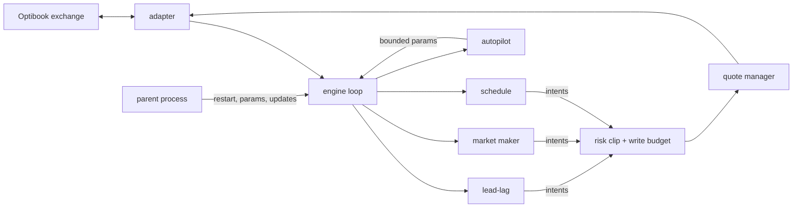

# optiver-hackathon

We are **ABZ Trading**, a team of four that competed in the **Optiver Coding Challenge at ETH Zürich on 6 November 2026**. It was a six-hour hackathon on **Optibook**, Optiver's simulated exchange, where each team's Python bot trades live against about 30 other teams and against Optiver's own market-making and taker bots.

This repo is the system we built and ran there:
- the trading bot we submitted, which runs as one stdlib-only Python 3.10 file built from `src/otk/`;
- the research and backtesting tools we used before and during the event to choose its strategies and parameters.

## The challenge

- **Instruments:** eight US tech stocks (AMD, AVGO, CRWV, MU, NBIS, NVDA, SNDK, VRT), tick size 0.1, position limits per stock.
- **Format:** several practice rounds through the afternoon, each started by an exchange reset, then a final round scored on PnL.
- **Rules:** one bot per team, one exchange session, and a message-rate limit.
- **Unknown in advance:** the format was announced only on the day. So we prepared a bot that reads the listed instruments and picks its strategies by itself, ready for dual listings, ETFs, futures, options and news.

## What we did on the day

1. **Measured the market before trading it.** We probed the API, recorded the order books, and recorded the public dashboard feed, which shows every trade with buyer and seller names.
2. **Profiled Optiver's bots from that tape.**
   - The house noise takers lose about 0.7 to 1.0 ticks per lot within 5 s, which is the flow a market maker earns from.
   - A house sweeper clears a whole side of the book and moves the price 24 to 58 ticks in under a second, with no warning in the book.
   - So we quoted on the follower stocks and pulled quotes from the leaders, which are the stocks that move first.
3. **Found lead-lag pairs.** AVGO leads NBIS, MU leads CRWV, and NVDA leads SNDK. When a leader moves, the follower's quotes stay stale for a moment. Our lead-lag strategy takes those stale quotes, and it became our main source of PnL. Counterparty analysis showed which participants were the slow quoters.
4. **Found that the market followed a script.** After each reset the house bots replayed the same price path: 21 of 24 large moves recurred within 3 s. We built, tested and shipped a schedule trader during the event. It trades the known moves, and stands down by itself when a round leaves the path, which the later rounds did.
5. **Handled the rounds' resets.** After each exchange reset the bot drops all price memory and waits for the real open before quoting.
6. **Improved the bot live, under statistical discipline.**
   - Every idea went through replay on that day's recording, an independent check, then a paired live test, and a pre-registered rule decided adoption, defaulting to no change.
   - About 150 trials were counted, because each extra test raises the bar for the next.
   - A small team of AI coding agents analysed the recordings and proposed changes through tested pull requests and bounded parameters. All trading stayed in the deterministic bot, and no agent ever placed an order.

**Tried and dropped, on the evidence:**
- **Fading moves (mean reversion).** It lost on every hour we tested, so it stayed off.
- **A tell before the house sweeps.** Prices showed no drift in the 30 s before a sweep.
- **Pulling every leader when one jumps.** Only 1 of 37 leader jumps moved more than one stock.
- **Gradient-boosted trees and deep nets live.** Six hours give only about 900 to 2,700 independent 2-second labels, so a bounded online ridge model was the ceiling.

**What we would do next:** scale passive quote size with the rate of aggressive flow. The biggest moves of the final came from flow that paid whoever had size resting in the book.

## The unusual part: trading a market that replays itself

Most bots treat prices as a random process to forecast. We found that this market was partly **deterministic**, and built a strategy that trades it as a replay, while testing online whether the replay still holds.

**The observation.** Optiver's sweeper bot hit the same leaders at the same second after each round's first trade.
- **Timing:** we timed 16 sweeps across two rounds to 0.1 s. One round's sweeps differed from the other's by a **constant 0.26 s (standard deviation 0.07 s)**. The same clock, slightly shifted.
- **Across long rounds:** a later round equalled an earlier one plus a fixed 4,705.24 s offset, within ±0.5 s, on 15 of 17 moves.
- **Spillover:** after each sweep, its follower stock moved too, and teams raced to take the follower's stale quotes.

**The mechanism** (`src/otk/schedule.py`):
1. **A clock anchored to the market, not the wall.** Round start `t0` is the first public trade after a reset, detected because trade ids restart near 1. Every leg is an offset from `t0`: a time, a stock, a direction and a size.
2. **Enter just before, exit just after.** Each leg enters a set fraction of a second before its scripted sweep, since an entry after the sweep pays the moved price, and closes a few seconds after. The table's times sit 0.3 s early for that reason. Our market-making quotes on that stock are pulled in between, so the sweep can't hit them.
3. **Followers ride their leader's leg.** A follower is included only where it moved at least 10 ticks in the source round, because thinner stale volume did not pay for crossing the spread.
4. **An online falsification test.** The script is a hypothesis, and each leg is a test of it. At a leg's exit the bot checks whether the price moved at least 2 ticks against the position. Two such legs in a row reject the path, and the strategy stands down for the rest of the round. A flat leg does not count as wrong: one flat leg in a source round would otherwise have given up the edge in every leg after it.
5. **Reset-safe.** On an exchange reset the clock clears and waits for the new round's first trade. A start time pinned by hand belongs to its own round and is ignored after a reset.

In the last rounds of the day the path changed: the scripted moves at 78, 406 and 652 s never came. We set the schedule's size to 0 by hand at that point, and the stand-down rule stayed on as the automatic backstop for the final.

## Two more ideas worth a look

- **Lead-lag at a learned, non-obvious ratio** (`src/otk/leadlag.py`).
  - On the practice exchange, three pairs moved with a 60 s return correlation of 1.00, with the follower 1 to 3 s behind. They moved at a fixed ratio that was neither 1 nor the ratio of their prices.
  - Nothing in the instrument list reveals the pairs, so the bot learns them while running, and always watches.
  - It does two things: it centres the follower's quotes on where the leader says the price is going, so resting orders are never stale, and it takes the follower by immediate-or-cancel when the gap exceeds the half spread.
  - The gap closes in about 2 s, too fast and too small to fade, so the bot never trades it the other way.
- **One code path for paper trading and backtest** (`src/otk/reversion.py`).
  - A strategy we doubted, mean reversion, could only switch itself on after paper trades at executable prices had paid after costs. The paper trades buy at the ask, sell at the bid, pay a haircut per fill, and take the live strategy's exits.
  - The same code scans a recording offline. So the live decision and the backtest cannot disagree about what reversion earned. It never earned, so it never went live.

## Architecture



- **`engine.py`**: a deterministic loop that runs every few milliseconds:
  - read every book and our positions;
  - collect intents from each strategy;
  - clip them through risk;
  - send the fewest order writes that reach the target quotes.
- **Strategies never touch the exchange.** They return intents, which keeps them pure and testable.
- **`adapter.py`** is the only module that talks to the exchange client.
- **`main.py`** splits the bot into a parent and a child:
  - the parent supervises the child, restarts it within seconds if it crashes, and applies new parameters or releases;
  - the child trades.
  - The exchange cancels our orders on disconnect, so a restarted child rebuilds its quotes from positions.

## Strategies

| Strategy | Mechanism | Module |
|---|---|---|
| **Lead-lag** | Some stocks consistently move first: AVGO→NBIS, MU→CRWV and NVDA→SNDK. Each pair's ratio is fitted online and seeded with measured values. When the leader's mid moves and the follower still shows a stale quote through fair value, the bot takes it with an immediate-or-cancel order. Caps: per take and per stock, and a guard period after jumps | `leadlag.py` |
| **Market making** | Two-sided quotes around a fair price (microprice, near-touch imbalance, wall mid), skewed against inventory, with queue priority kept and at most a one-tick improvement | `strategies.py`, `quoter.py`, `quote_manager.py`, `fair.py` |
| **Schedule** | The house bots replayed a fixed price path after each exchange reset. This trades the known moves from the round's first trade, and stands down after two legs go against it | `schedule.py` |

These are built for other formats and are switched off unless the exchange lists the matching instruments:
- dual-listing arbitrage and gap reversion;
- ETF, index and future theo;
- options with Black-Scholes;
- news trading;
- mean-reversion taking.

`formats.py` reads the exchange's listings and picks the format by itself.

## Risk

- **`risk.py`:** worst-case position capacity per instrument, including resting orders, plus a delta watch and a drawdown stop.
- **`budget.py`:** a rolling message-rate budget. When writes are scarce it rotates them across instruments, and it adds hysteresis so quotes don't flicker.
- **`kill.py`:** kill switches. Losses flatten the book and cool off. Plumbing faults (stale data, a burst of rejects, a disabled parameter) only pull quotes, and trading resumes once the fault clears. `scripts/kill_drill.py` triggers each one on the simulator.
- **Resets:** after an exchange reset or reconnect, the bot clears every price memory, stays quiet for 10 s, and lead-lag waits 15 s for the real open.

## Adaptation and evaluation

- **`params.py`:** every tunable value is a named parameter with hard bounds. The parameter file is the only way to change the running bot.
- **`autopilot.py`:** every 30 s it retunes spread and skew per instrument from our own fill markouts, within bounds. `reversion.py` paper-trades a strategy at real prices before it may go live.
- **`replay.py`:** replays a recorded market through the real engine, with order latency, so a parameter change is judged on the real book before it goes live.
- **`evaluation.py`, `allocator.py`, `livetest.py`:**
  - paired switchback live tests: variants alternate in time slices with washouts;
  - a pre-registered adoption rule, defaulting to no change;
  - a deflated Sharpe ratio, so many trials don't flatter a winner;
  - a CUSUM incumbent gate.
- **`updater.py`:** pulls released builds and parameters from a repository branch into the running bot, and rolls back automatically on failure.

## Research and backtesting tools

These ran on laptops against recorded markets, never inside the live bot.

| Tool | What it answers |
|---|---|
| `booklab.py`, `scripts/book_lab.py` | How a book behaves: regime, imbalance, the passive fill surface, arbitrage windows, and what each level of latency is worth |
| `behaviour.py`, `scripts/analyze_capture.py` | Capture report: spreads, sizes, reversion half-life, lead-lag between instruments, jumps |
| `scripts/backtest_grid.py` | Parameter grid through the real engine. It picks a plateau (the median of neighbours), never the single best point |
| `overfit.py` | Probability of backtest overfitting (CSCV), deflated Sharpe ratio, minimum backtest length |
| `online_model.py` | Online ridge regression bounded in ticks, with a skill gate. Six hours give only about 900 to 2,700 independent 2-second labels, so this is the ML ceiling: no trees or deep nets live |
| `scripts/switchback.py` | Paired switchback test of parameter variants in time slices with washouts |
| `scripts/pick_params.py` | Chooses from a fixed list of changes by replaying the last hour, with no model |
| `scripts/reversion_scan.py` | Would fading have paid on this capture, and would the paper-trading rule have caught it |
| `scripts/sim_tournament.py` | Strategy stack against simulated bots across seeds: mechanics and robustness, not parameter values |
| `scripts/bench_tick.py` | Time per engine tick |
| `scripts/emergency_bot.py` | A minimal standalone quoting bot that shares no code with the main bot, for when the main bot cannot run |
| `scripts/fetch_public_data.sh` | Downloads public Optibook order-book data to test on |

## Run it

```bash
uv sync
uv run pytest -q                                                     # 1,115 tests
uv run python scripts/run_bot.py --sim dual --adverse --seconds 30    # the full stack on the built-in simulator
uv run python scripts/kill_drill.py                                  # every kill switch, in seconds
uv run python scripts/make_single_file.py --out dist/optibook_bot.py  # the single file to upload
```

`src/otk/sim/` is an exchange simulator that enforces the rules: price-time priority, message limits, position limits, and bots that take, quote and sweep. The real `optibook` client exists only in the event's environment and is not included.

On the exchange's environment:

| Command | Job |
|---|---|
| `python scripts/probe_exchange.py` | Check the API and the instruments, with no orders |
| `python optibook_bot.py` | Run the bot |
| `python scripts/set_params.py '{"size": 5}' --why "..."` | Change a parameter live, within bounds |
| `touch run/KILL` | Pull every quote |
| `touch run/FLATTEN` | Close out |
| `python scripts/record_market.py` | Passive capture |
| `scripts/visualiser_feed.py` | Record the public dashboard feed of named trades and the leaderboard, with no exchange login |

## Layout

```
src/otk/       engine, adapter, strategies, lead-lag, schedule, quoting, fair value, risk, budget, kill,
               autopilot, params, replay, evaluation, updater, supervisor (main.py),
               book lab, behaviour report, overfitting statistics, online ridge
src/otk/sim/   exchange simulator, bots, scenarios, harness
scripts/       build, simulator run, kill drill, live parameter and kill tools, recorders,
               backtest grid, switchback, replay picks, capture analysis, emergency bot
config/        example event settings and presets per format
tests/         unit and integration tests
```

MIT licensed.
