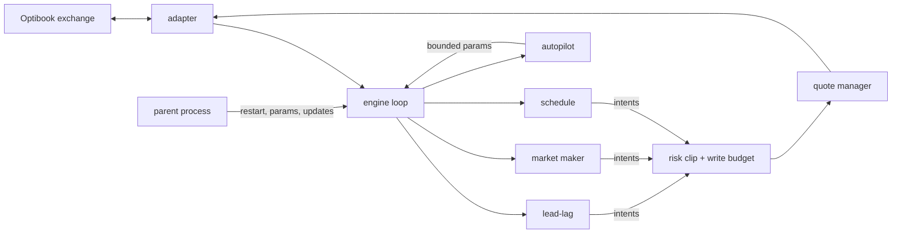

# optibook-bot

An automated trading bot for **Optibook**, Optiver's simulated exchange, built for the Optiver Coding Challenge at ETH Zürich on 6 November 2026. It traded eight stocks live for six hours against about 30 teams and Optiver's own market-making and taker bots. In the challenge's first trading round it **ranked #1 on the live leaderboard**.

The bot runs as one stdlib-only Python 3.10 file, built from the package in `src/otk/`.

## Architecture



- **`engine.py`**: a deterministic loop that runs every few milliseconds:
  - read every book and our positions;
  - collect intents from each strategy;
  - clip them through risk;
  - send the fewest order writes that reach the target quotes.
- **Strategies never touch the exchange.** They return intents, which keeps them pure and testable.
- **`adapter.py`** is the only module that talks to the exchange client.
- **`main.py`** splits the bot into a parent and a child:
  - the parent supervises the child, restarts it within seconds if it crashes, and applies new parameters or releases;
  - the child trades.
  - The exchange cancels our orders on disconnect, so a restarted child rebuilds its quotes from positions.

## Strategies

| Strategy | Mechanism | Module |
|---|---|---|
| **Lead-lag** | Some stocks consistently move first: AVGO→NBIS, MU→CRWV and NVDA→SNDK. Each pair's ratio is fitted online and seeded with measured values. When the leader's mid moves and the follower still shows a stale quote through fair value, the bot takes it with an immediate-or-cancel order. Caps: per take and per stock, and a guard period after jumps | `leadlag.py` |
| **Market making** | Two-sided quotes around a fair price (microprice, near-touch imbalance, wall mid), skewed against inventory, with queue priority kept and at most a one-tick improvement | `strategies.py`, `quoter.py`, `quote_manager.py`, `fair.py` |
| **Schedule** | The house bots replayed a fixed price path after each exchange reset. This trades the known moves from the round's first trade, and stands down after two legs go against it | `schedule.py` |

These are built for other formats and are switched off unless the exchange lists the matching instruments:
- dual-listing arbitrage and gap reversion;
- ETF, index and future theo;
- options with Black-Scholes;
- news trading;
- mean-reversion taking.

`formats.py` reads the exchange's listings and picks the format by itself.

## Risk

- **`risk.py`:** worst-case position capacity per instrument, including resting orders, plus a delta watch and a drawdown stop.
- **`budget.py`:** a rolling message-rate budget. When writes are scarce it rotates them across instruments, and it adds hysteresis so quotes don't flicker.
- **`kill.py`:** kill switches. Losses flatten the book and cool off. Plumbing faults (stale data, a burst of rejects, a disabled parameter) only pull quotes, and trading resumes once the fault clears. `scripts/kill_drill.py` triggers each one on the simulator.
- **Resets:** after an exchange reset or reconnect, the bot clears every price memory, stays quiet for 10 s, and lead-lag waits 15 s for the real open.

## Adaptation and evaluation

- **`params.py`:** every tunable value is a named parameter with hard bounds. The parameter file is the only way to change the running bot.
- **`autopilot.py`:** every 30 s it retunes spread and skew per instrument from our own fill markouts, within bounds. `reversion.py` paper-trades a strategy at real prices before it may go live.
- **`replay.py`:** replays a recorded market through the real engine, with order latency, so a parameter change is judged on the real book before it goes live.
- **`evaluation.py`, `allocator.py`, `livetest.py`:**
  - paired switchback live tests: variants alternate in time slices with washouts;
  - a pre-registered adoption rule, defaulting to no change;
  - a deflated Sharpe ratio, so many trials don't flatter a winner;
  - a CUSUM incumbent gate.
- **`updater.py`:** pulls released builds and parameters from a repository branch into the running bot, and rolls back automatically on failure.

## Run it

```bash
uv sync
uv run pytest -q                                                     # 933 tests
uv run python scripts/run_bot.py --sim dual --adverse --seconds 30    # the full stack on the built-in simulator
uv run python scripts/kill_drill.py                                  # every kill switch, in seconds
uv run python scripts/make_single_file.py --out dist/optibook_bot.py  # the single file to upload
```

`src/otk/sim/` is an exchange simulator that enforces the rules: price-time priority, message limits, position limits, and bots that take, quote and sweep. The real `optibook` client exists only in the event's environment and is not included.

On the exchange's environment:

| Command | Job |
|---|---|
| `python scripts/probe_exchange.py` | Check the API and the instruments, with no orders |
| `python optibook_bot.py` | Run the bot |
| `python scripts/set_params.py '{"size": 5}' --why "..."` | Change a parameter live, within bounds |
| `touch run/KILL` | Pull every quote |
| `touch run/FLATTEN` | Close out |
| `python scripts/record_market.py` | Passive capture |
| `scripts/visualiser_feed.py` | Record the public dashboard feed of named trades and the leaderboard, with no exchange login |

## Layout

```
src/otk/       engine, adapter, strategies, lead-lag, schedule, quoting, fair value, risk, budget, kill,
               autopilot, params, replay, evaluation, updater, supervisor (main.py)
src/otk/sim/   exchange simulator, bots, scenarios, harness
scripts/       build, simulator run, kill drill, live parameter and kill tools, recorders
config/        example event settings and presets per format
tests/         unit and integration tests
```

MIT licensed.
